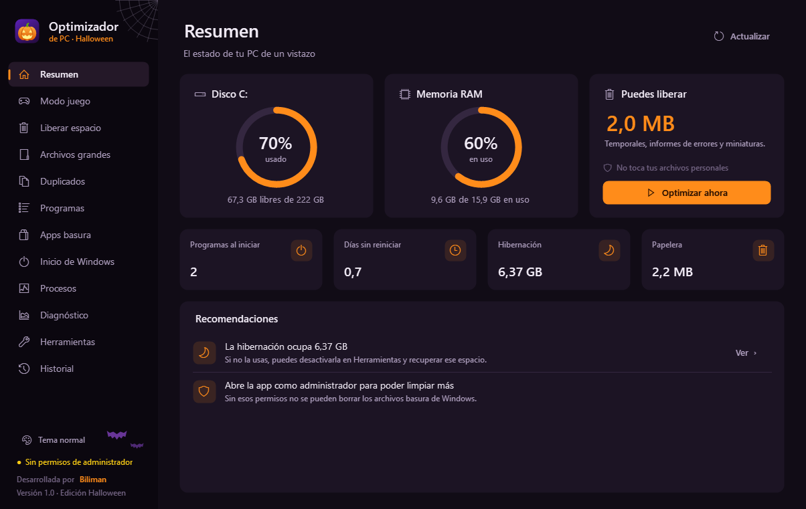
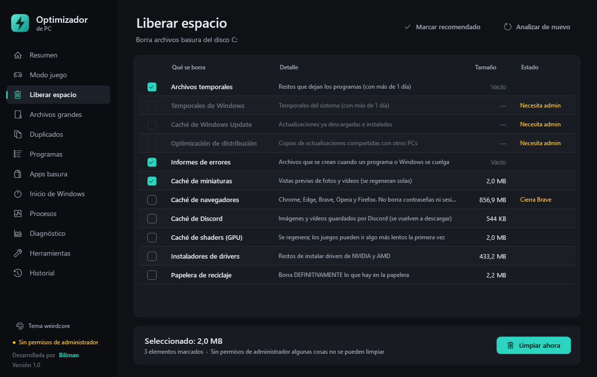
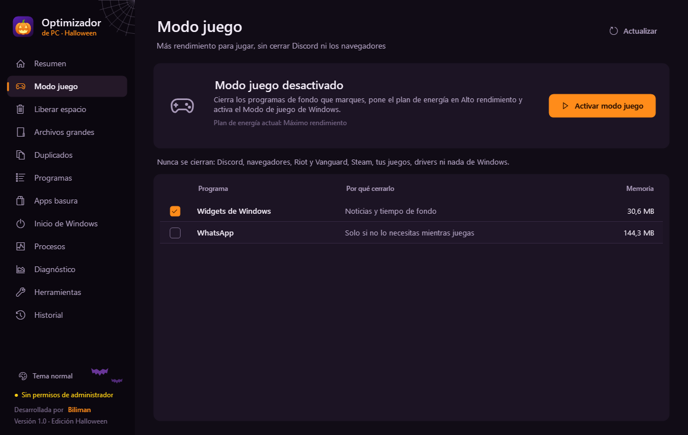
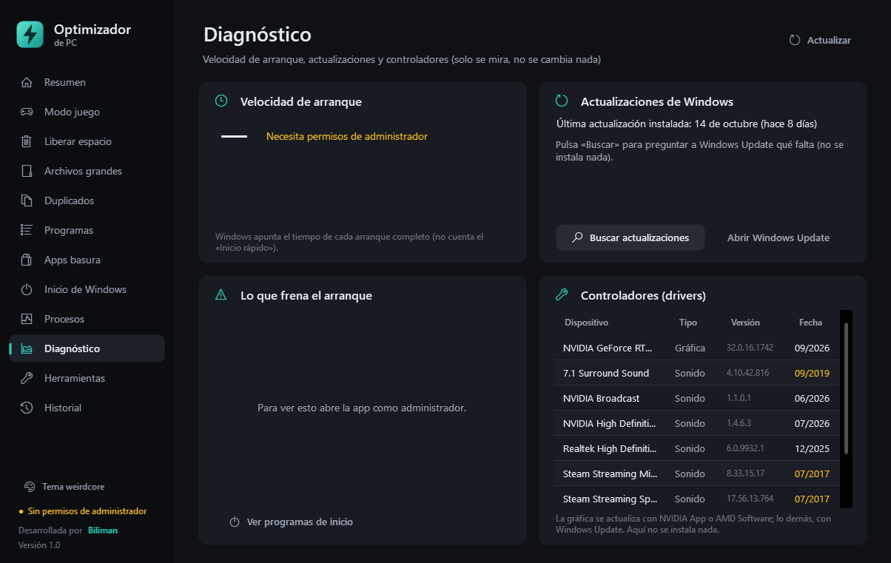
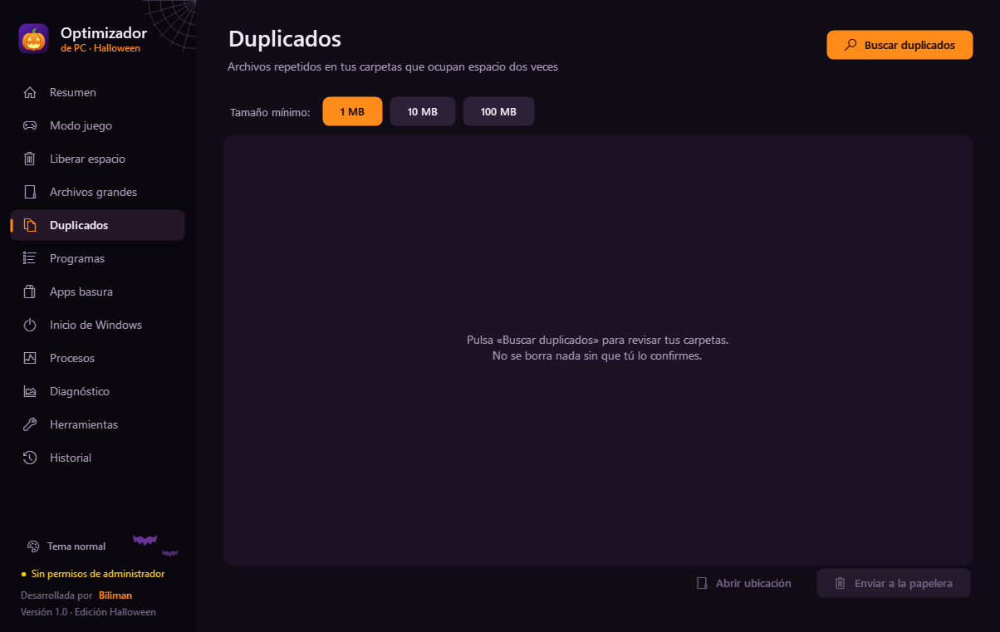

# 🎃 Optimizador de PC

Aplicación para Windows 10 y 11 que libera espacio en el disco C: y evita que el PC se sature de programas basura.
Un solo `.exe`, sin instalar nada, en español y con tema oscuro (edición Halloween incluida).

**Desarrollada por Biliman.**



## Descargar

Ve a **[Releases](../../releases)** y descarga `OptimizadorPC.exe`. Haz doble clic: Windows pedirá permisos de
administrador (los necesita para limpiar los archivos de Windows).

> La primera vez Windows puede mostrar **"Windows protegió su PC"** porque la app no tiene firma digital
> (un certificado de pago). Pulsa **Más información → Ejecutar de todas formas**.

## Qué hace

| Sección | Para qué sirve |
|---|---|
| **Resumen** | Uso del disco y la RAM, cuánto puedes liberar, botón *Optimizar ahora* y recomendaciones. |
| **Modo juego** | Cierra programas de fondo, activa el Modo de juego de Windows y sube el plan de energía. Nunca cierra Discord, navegadores, Riot/Vanguard, Steam ni tus juegos. Al desactivarlo lo deja todo como estaba. |
| **Liberar espacio** | Temporales, caché de Windows Update, informes de errores, miniaturas, cachés de navegadores y Discord, restos de drivers y papelera. Tú eliges qué se borra. |
| **Archivos grandes** | Encuentra lo que más ocupa en tus carpetas y lo manda a la papelera. |
| **Duplicados** | Archivos idénticos byte a byte (huella SHA-256). Siempre conserva una copia. |
| **Programas** | Desinstala programas, espera a que el desinstalador termine de verdad y busca sus restos (carpetas, registro y accesos directos), como Geek Uninstaller o Revo. Tú eliges qué restos borrar y al final ves un informe con cada uno (✓ borrado / ✗ no se pudo). Guarda una copia `.reg` antes de borrar nada del registro. |
| **Apps basura** | Quita apps de la Tienda por completo (también la copia que Windows usa para reinstalarlas) y te enseña sus restos para elegir qué borrar. |
| **Inicio de Windows** | Activa o apaga lo que arranca con el PC, igual que el Administrador de tareas (reversible). |
| **Procesos** | Lo que consume RAM y CPU ahora mismo. Las partes de Windows están protegidas. |
| **Diagnóstico** | Velocidad de arranque y qué lo frena, actualizaciones pendientes y antigüedad de los controladores. Solo lee. |
| **Herramientas** | Punto de restauración, limpieza profunda (DISM), hibernación, limpieza semanal automática, accesos directos y sonidos. |
| **Historial** | Todo el espacio que has liberado con la app. |

Temas: **Halloween** 🎃 y **normal**, con sonidos y animaciones propios. Hay algo más escondido para quien sepa buscar. 👀

| | |
|---|---|
|  |  |
|  |  |

## Seguridad

- Nada se borra ni se cambia sin que pulses un botón **y** confirmes en un aviso.
- Nunca vacía carpetas del sistema (Windows, Archivos de programa, tu carpeta de usuario…) aunque una ruta se resuelva mal, y no sigue enlaces (*junctions*).
- Los archivos en uso o creados hace menos de un día se saltan.
- Desinstalar, apagar programas de inicio y el modo juego se pueden revertir; lo que va a la papelera se puede recuperar.
- Todo lo que hace queda anotado en `%LOCALAPPDATA%\OptimizadorPC\registro.log`.

## Compilar desde el código

No hace falta instalar nada: usa el compilador de C# que ya trae Windows (.NET Framework 4.8).

```powershell
powershell -ExecutionPolicy Bypass -File .\build.ps1          # dist\OptimizadorPC.exe (pide administrador)
powershell -ExecutionPolicy Bypass -File .\build.ps1 -Prueba  # dist\OptimizadorPC_prueba.exe (sin administrador)
```

Al subir una etiqueta de versión (`git tag v1.0` + `git push --tags`), GitHub compila la app y la publica sola en *Releases*.

### Pruebas automáticas

```powershell
powershell -ExecutionPolicy Bypass -File .\pruebas\compilar_pruebas.ps1
%TEMP%\opc_pruebas2\PruebasOptimizador.exe /salida informe.txt          # sin administrador
%TEMP%\opc_pruebas2\PruebasOptimizador.exe /admin /salida informe.txt   # como administrador
```

Usan las pantallas y el motor reales sobre datos de prueba (carpetas, un programa falso con restos, entradas de inicio, procesos…).
Ojo: la sección *Liberar espacio* limpia de verdad los temporales y miniaturas, y como administrador se prueban la hibernación,
la tarea semanal y DISM (todo se deja como estaba).

### Estructura

```
src/            Núcleo: tema, controles, motor de limpieza, restos, modo juego, duplicados, diagnóstico...
src/Paginas/    Una clase por sección de la app
recursos/       Icono y manifiestos (administrador / pruebas)
pruebas/        Pruebas automáticas
```

## Licencia

[MIT](LICENSE) © 2026 Biliman
